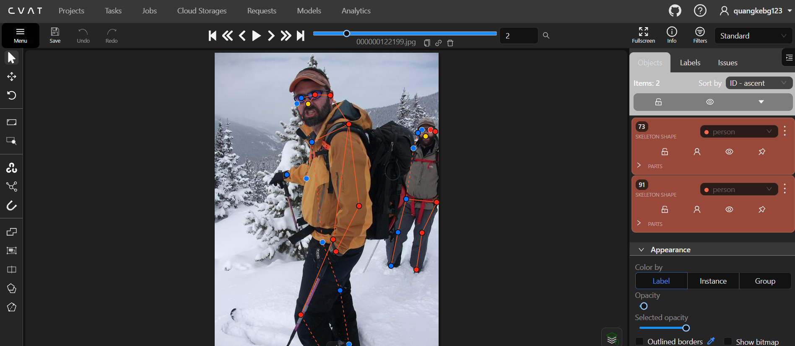
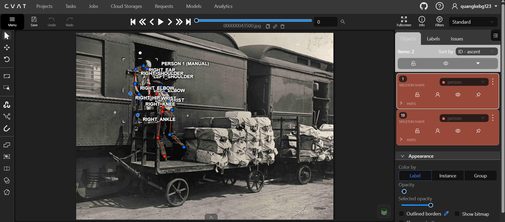
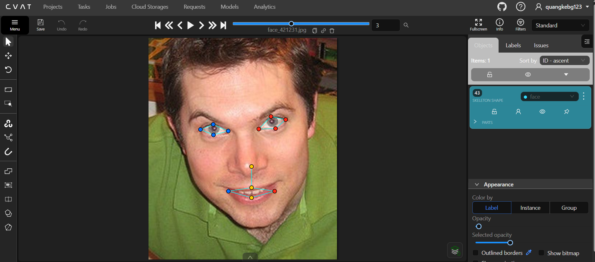

# Báo cáo cá nhân — HoVaTen-MSSV

Đổi tên file theo quy tắc `MSSV_HoTen.md`. Ví dụ: `20241234_NguyenVanAn.md`.

Dữ liệu: 12 ảnh người COCO val2017 (Lin et al., 2014) và 8 ảnh chân dung Wikimedia Commons, chỉ dùng trong lớp.

## 0. Thông tin học viên

- Họ tên: Nguyễn Mạnh Quang
- MSSV:2A202603241
- Email:quangkebg123@gmail.com
- Link repository:https://github.com/quangkebg123/K5-L2-DAY04-NguyenManhQuang-2A202603241-KeypointPose-Student
- Phiên bản CVAT (Help → About):2.74.1
- Máy: hệ điều hành Windois\_ · RAM \_8 GB · chạy CVAT chế độ đầy đủ / lite
- Bộ ảnh (`src/exports/assignment.json` do `lab.py setup` tạo): có / không
- Giờ bắt đầu:16h30
- Giờ kết thúc:12h

## 1. Kiểm tra label (CP0)

| Label    | Kiểu     | Số điểm | Tên điểm đúng bảng của lab? | Đúng thứ tự? | Số cạnh |
| -------- | -------- | ------: | --------------------------- | ------------ | ------: |
| `person` | Skeleton |      17 | Có                          | Có           |      19 |
| `face`   | Skeleton |      13 | Có                          | Có           |      13 |

Mẫu `person` dựng theo người quay mặt về camera (các điểm `left_*` nằm bên phải khung mẫu)? **Có**

Cách đổi cờ `occluded` / `outside` cho **một điểm** trên phiên bản CVAT này (một câu):

Rê chuột lên đúng điểm rồi nhấn `Q` để bật/tắt `occluded` (`v = 1`), nhấn `O` để bật/tắt `outside` (`v = 0`), hoặc nhấp chuột phải vào điểm và chọn cờ tương ứng.

## 2. Số lượng đã gán và thời gian (CP1, CP2)

| Nhóm ảnh   | Số ảnh | Số skeleton đã gán | Số người dưới 60 px (không gán) | Số poster / gương / màn hình bỏ qua | Thời gian thực tế (phút) |
| ---------- | -----: | -----------------: | ------------------------------: | ----------------------------------: | ---------------: |
| `easy`     |      5 |                  5 |                                 |                                     |                  |
| `occluded` |      3 |                  5 |                                 |                                     |                  |
| `back`     |      2 |                  4 |                                 |                                     |                  |
| `small`    |      1 |                  4 |                                 |                                     |                  |
| `crowd`    |      1 |                  3 |                                 |                                     |                  |
| `faces`    |      8 |                  8 |                               — |                                     |                  |

Ghi chú: số skeleton lấy từ hai file xuất hiện có. Các ô về người dưới 60 px, poster/gương/màn hình và thời gian cần đối chiếu với lúc gán nhãn; file xuất không cho biết số liệu này. Script tự kiểm cảnh báo hai skeleton có các điểm chỉ trải cao dưới 60 px trong ảnh `000000572411.jpg` (#3: 28 px, #4: 25 px); cần kiểm tra và bỏ nếu đúng là người dưới ngưỡng.

- Nhịp tham khảo `CHECKPOINTS.md` (mục tiêu, không phải thời gian thực tế): `easy` ~25 phút; `occluded` ~21; `back` ~16; `small` ~8; `crowd` ~14 (CP1 tổng nhịp ~84 phút trong 90 phút); `faces` ~24 phút gán + 6 phút self-QC (CP2 30 phút).
- Số ảnh người đã xong ở mốc phút 105: \_\_\_ / 12 (mục tiêu tối thiểu 8 / 12)
- Số ảnh người đã xong ở mốc phút 150: \_\_\_ / 12 (mục tiêu 12 / 12)
- Thời gian thực tế: CP1 \_\_\_ / 90 phút · CP2 \_\_\_ / 30 phút · CP3 \_\_\_ / 20 phút
- Ảnh tốn thời gian nhất là ảnh nào, vì sao?

Chưa ghi nhận thời gian cho từng ảnh; điền ảnh và lý do theo thời gian thực tế.

## 3. Bảng ca khó (CP1, CP2)

Mỗi điểm bạn phân vân một dòng, nhất là phân vân giữa `v = 1` và `v = 0`, hoặc không chắc hướng người.

| Ảnh                | Người / mặt | Điểm             |           Cờ đã chọn | Phân vân giữa                              | Lý do chọn                                                                                                      |
| ------------------ | ----------- | ---------------- | -------------------: | ------------------------------------------ | --------------------------------------------------------------------------------------------------------------- |
| `000000043500.jpg` | Người #1    | `right_hip`      | `occluded` (`v = 1`) | `occluded` / `outside` (`v = 1` / `v = 0`) | Hông bị hàng hóa che nhưng vẫn ước lượng được từ hướng thân và các khớp lân cận.                                |
| `000000109010.jpg` | Người #3    | `left_ankle`     |  `outside` (`v = 0`) | `occluded` / `outside` (`v = 1` / `v = 0`) | Cổ chân bị che/cắt ở phần dưới ảnh, không có đủ mốc để ước lượng chắc vị trí.                                   |
| `face_296767.jpg`  | Mặt #3      | `left_eye_upper` | `occluded` (`v = 1`) | `occluded` / `outside` (`v = 1` / `v = 0`) | Kính râm che mắt nhưng vị trí mí trên ước lượng được theo gọng kính; không nhìn thấy rõ nên không chọn `v = 2`. |

Các ví dụ trên được đối chiếu từ cờ trong file xuất; chỉ giữ những dòng bạn thực sự đã phân vân khi gán nhãn.

## 4. Bảng tự review (CP3)

Đi từ ảnh cuối về ảnh đầu. 5 ảnh người (ít nhất 2 ảnh `back` hoặc `crowd`) và 3 ảnh mặt. Ít nhất 8 dòng, kể cả dòng `ok`. Ghi lỗi trước, sửa sau.

Mã lỗi dùng đúng một trong: `lr_swap`, `vis_flag`, `position`, `missing`, `extra`, `ok`.

| Ảnh                | Người / mặt                 | Điểm                         | Mã lỗi    | Ghi chú                                                                                                  | Đã sửa?   |
| ------------------ | --------------------------- | ---------------------------- | --------- | -------------------------------------------------------------------------------------------------------- | --------- |
| `000000413160.jpg` | Người #1–#3                 | Các điểm đã gán              | `ok`      | Đã kiểm đủ 3 người trong ảnh; các khớp khuất/ngoài khung đã đặt cờ.                                      | Không cần |
| `000000572411.jpg` | Người #4                    | Skeleton                     | `extra`   | Checker báo các điểm chỉ trải cao 25 px; xác nhận người này dưới 60 px trước khi bỏ.                     | Chưa sửa  |
| `000000572411.jpg` | Người #3                    | Skeleton                     | `extra`   | Checker báo các điểm chỉ trải cao 28 px; xác nhận người này dưới 60 px trước khi bỏ.                     | Chưa sửa  |
| `000000572411.jpg` | Người #1                    | `left_wrist` / `right_wrist` | `lr_swap` | Checker báo cặp cổ tay ngược phía với các cặp còn lại; kiểm tra lại xem có phải tay bắt chéo thật không. | Chưa sửa  |
| `000000518966.jpg` | Người #1–#2                 | Các điểm đã gán              | `ok`      | Đã kiểm trái/phải của người quay lưng và các điểm ngoài khung của người bị cắt.                          | Không cần |
| `000000043500.jpg` | Người #1–#2                 | Các điểm đã gán              | `ok`      | Đã kiểm hai người trong cảnh; các phần bị che được gán cờ phù hợp.                                       | Không cần |
| `000000147780.jpg` | Người mặc áo xanh cạnh ngựa | Toàn người                   | `missing` | Người thật cao trên 60 px nhìn thấy trong ảnh nhưng chưa có skeleton.                                    | Chưa sửa  |
| `face_560282.jpg`  | Mặt #1                      | 13 điểm                      | `ok`      | Đã kiểm vị trí hai mắt, chóp mũi và khóe miệng; các điểm nhìn thấy được gán `v = 2`.                     | Không cần |
| `face_296767.jpg`  | Mặt #1                      | 8 điểm quanh mắt             | `ok`      | Kính râm che mắt; các điểm mắt được gán `occluded` (`v = 1`) theo guideline.                             | Không cần |
| `face_178208.jpg`  | Mặt #1                      | 13 điểm                      | `ok`      | Mắt nhìn thấy qua kính trong; trái/phải và các điểm môi đã kiểm.                                         | Không cần |

Tổng hợp số lỗi theo mã:

| `lr_swap` | `vis_flag` | `position` | `missing` | `extra` | `ok` |
| --------: | ---------: | ---------: | --------: | ------: | ---: |
|         1 |          0 |          0 |         1 |       2 |    6 |

Điểm còn phân vân giữa `v = 1` và `v = 0` (ghi cả hai lựa chọn và lý do chọn):

`000000043500.jpg`, người #1, `right_hip`: chọn `v = 1` thay vì `v = 0` vì hông bị che nhưng ước lượng được từ thân và khớp lân cận. `000000109010.jpg`, người #3, `left_ankle`: chọn `v = 0` thay vì `v = 1` vì không đủ mốc để ước lượng chắc vị trí. `face_296767.jpg`, `left_eye_upper`: chọn `v = 1` thay vì `v = 0` vì kính râm che mắt nhưng gọng giúp ước lượng vị trí.

## 5. Kiểm file xuất và kết quả tự kiểm (CP4)

Tự kiểm tay trong file JSON:

| File                          | Người / mặt kiểm (ảnh, thứ tự)    | Số phần tử `keypoints` | Điểm `outside` ra `v = 0`, `occluded` ra `v = 1`? | `num_keypoints` khớp? |
| ----------------------------- | --------------------------------- | ---------------------: | ------------------------------------------------- | --------------------- |
| `NguyenManhQuang_persons.zip` | `000000043500.jpg`, annotation #1 |                     51 | Có (`v = 0` và `v = 1`)                           | Có                    |
| `NguyenManhQuang_persons.zip` | `000000109010.jpg`, annotation #3 |                     51 | Có (`v = 0` và `v = 1`)                           | Có                    |
| `NguyenManhQuang_faces.zip`   | `face_296767.jpg`, annotation #3  |                     39 | Có (`v = 1`; mẫu này không có `v = 0`)            | Có                    |

Sau khi xuất, CVAT ghi `occluded` thành `v = 1` và `outside` thành `v = 0`. Tọa độ của điểm `outside` trong file là tọa độ cũ.

Hai job đã chuyển sang completed trên CVAT? Có

Dán phần **TÓM TẮT** in ra từ `src/check_submission.py`:

```text
- File person: NguyenManhQuang_persons.zip
  Số ảnh: 12 · số skeleton `person`: 21 · mỗi annotation 51 số
  Skeleton theo ảnh: 000000043500=2, 000000109010=2, 000000122199=2, 000000147780=1, 000000150500=1, 000000225138=1, 000000336477=1, 000000343057=1, 000000413160=3, 000000518966=2, 000000564304=1, 000000572411=4
  Cờ v: v=2 235 (66%) · v=1 38 (11%) · v=0 84 (24%)
  num_keypoints trung bình: 13.0
- File face: NguyenManhQuang_faces.zip
  Số ảnh: 8 · số skeleton `face`: 8 · mỗi annotation 39 số
  Skeleton theo ảnh: face_178208=1, face_261458=1, face_296767=1, face_421231=1, face_476363=1, face_496353=1, face_53580=1, face_560282=1
  Cờ v: v=2 90 (87%) · v=1 14 (13%) · v=0 0 (0%)
  num_keypoints trung bình: 13.0
- Ghi chú: 84 điểm v = 0 vẫn mang tọa độ cũ (CVAT 2.x xuất như vậy; chuẩn COCO ghi 0, 0). Không phải lỗi: điểm v = 0 bị bỏ qua khi huấn luyện và khi chấm.
- Số [LỖI]: 0 · số [CẢNH BÁO]: 5
Kết quả: ĐẠT (đọc lại từng cảnh báo ở trên)
```

Các `[CẢNH BÁO]` còn giữ nguyên và lý do:

- `000000122199.jpg #2`, `000000343057.jpg #1`: gối/cổ chân lệch trái-phải so với các cặp còn lại; chưa xác nhận là gán nhầm hay tư thế chân bắt chéo.
- `000000572411.jpg #1`: cổ tay lệch trái-phải; cần kiểm tra lại hướng hai tay.
- `000000572411.jpg #3` và `#4`: điểm chỉ trải cao 28 px và 25 px; cần xác nhận người dưới 60 px hay người cao hơn nhưng bị cắt/che.

## 6. Ảnh chụp màn hình

1. Label `person` trong label constructor (đủ 17 điểm có tên):

    

2. Một người quay lưng đã gán, cờ đã đặt:

    

3. Một khuôn mặt đã gán 13 điểm, phóng to vùng mắt:

    

4. Một đoạn JSON xuất của một người:

    

Nguồn ảnh: COCO val2017 / Wikimedia Commons.

## 7. Tự đánh giá

1. Lỗi bạn mắc nhiều nhất hôm nay, và cách bạn sẽ tránh ở dự án thật:

    Lỗi mình cần chú ý nhất là trái/phải khi người bị che hoặc quay lưng. Checker còn cảnh báo cặp cổ tay ở `000000572411.jpg` và cặp gối/cổ chân ở `000000122199.jpg`, `000000343057.jpg`; đây là các ca cần phân biệt đổi nhãn với tay/chân bắt chéo thật. Trong dự án thật, mình sẽ xác định hướng người trước, lần theo vai → khuỷu → cổ tay và hông → gối → cổ chân, rồi phóng to kiểm từng cảnh báo trước khi xuất.

2. Một quy tắc bạn đề xuất thêm vào guideline (kèm ảnh ví dụ nếu có):

    Khi checker báo các điểm của một skeleton chỉ trải cao dưới 60 px, không kết luận ngay người đó dưới ngưỡng: kiểm tra toàn ảnh để phân biệt người thật sự nhỏ với người bị xe, đám đông hoặc mép ảnh che khuất. Chỉ bỏ skeleton nếu chiều cao người thực sự dưới 60 px; nếu người cao hơn thì vẫn gán và đặt cờ cho từng khớp theo mức nhìn thấy. Ví dụ cần rà soát: `000000572411.jpg`.

3. Nhãn của bạn đi vào model ở đâu? Chọn một lỗi bạn đã sửa và nói nó sẽ làm model học sai thế nào (heatmap, trọng số trong loss, hay bước lật ảnh):

    Mình phát hiện lỗi `missing` ở `000000147780.jpg`: người mặc áo xanh cạnh ngựa chưa có skeleton; lỗi này hiện chưa được sửa trên CVAT. Nếu giữ nguyên, người đó không tạo nhãn đích/heatmap cho 17 khớp, nên model không được học vị trí khớp của người trong tình huống tương tự và có thể bỏ sót họ. Mình cần bổ sung skeleton trong CVAT rồi xuất và kiểm tra lại.

## 8. Khó khăn và lỗi kỹ thuật

...

## Bonus (nếu làm)

### B1 — 3 ảnh người khó thêm

| Ảnh | Số skeleton | Số người dưới 60 px | Ca khó nhất |
| --- | ----------: | ------------------: | ----------- |
|     |             |                     |             |
|     |             |                     |             |
|     |             |                     |             |

Kết quả `src/check_submission.py` cho `HoVaTen_bonus_persons.zip`:

```text
(dán ở đây)
```

### B2 — 5 ảnh khuôn mặt đen trắng / hồng ngoại

Ảnh không màu khó hơn ở điểm nào? Kính râm trên ảnh hồng ngoại có còn là `v = 1` không?

...

### B3 — Model so với nhãn của tôi (không tính điểm)

- Demo đã dùng:
- Ảnh đã thử:

1. Model có trả điểm cho khớp bị che, hay khớp ngoài ảnh không? Confidence ở các điểm đó thế nào?

    ...

2. Với người quay lưng, model có đổi trái/phải không?

    ...

3. Bộ điểm của model có giống 17 điểm COCO không?

    ...

## 9. Tài liệu tham khảo và công cụ AI đã dùng

...
